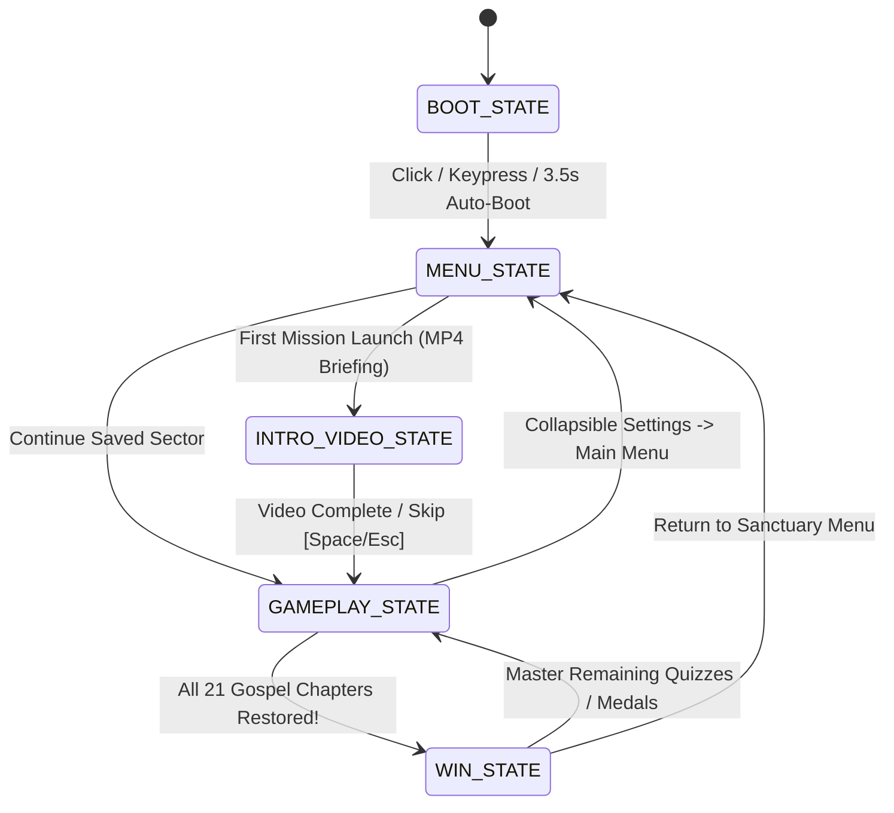
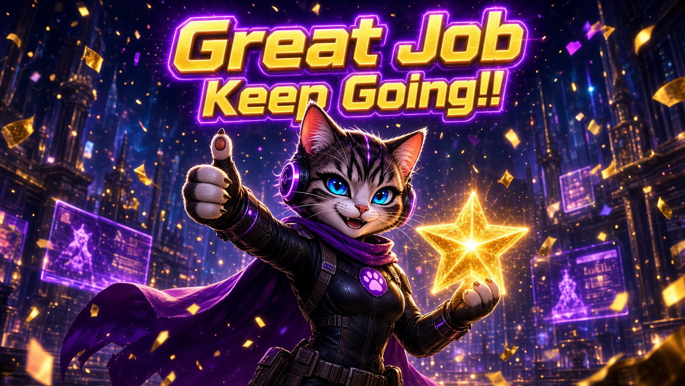

<div align="center">

# 🐾 JOURNEY THROUGH JOHN 2.0
### **HYPERKITTY // THE LOGOS PROTOCOL**
*An Epic Cyberpunk Stealth-Platformer, Authentic Cryptography Lab & 21-Chapter Gospel of John Study Experience*

[](#credits--team-legacy)
[](#-technical-architecture)
[-ffd24c?style=for-the-badge&labelColor=0b0e22)](#-heavy-bible-learning-suite)
[](#-authentic-cryptography--sigint-arsenal)

<br />


<br />

> *“In the beginning was the Word, and the Word was with God, and the Word was God... And the light shineth in darkness; and the darkness comprehended it not.”* — **John 1:1, 5 (KJV)**

[**▶ Launch Single-File Game (`JourneyThroughJohn_TeamLegacy_Enhanced.html`)**](./JourneyThroughJohn_TeamLegacy_Enhanced.html) &nbsp;•&nbsp;
[**🛰 Open OmniTool V3 Web Deck**](https://2ndchances520.github.io/OmniToolV3/) &nbsp;•&nbsp;
[**⏳ Explore "What is Time"**](https://2ndchances520.github.io/WhatIsTime/) &nbsp;•&nbsp;
[**⚙ Wehrmacht Enigma Simulator**](https://people.physik.hu-berlin.de/~palloks/js/enigma/enigma-u_v20_en.html)

</div>

---

## ⚡ Mission Briefing: What Is *The Logos Protocol*?

In a neon-drenched digital dark age, automated **Redaction Sentries** patrol the **Black Chamber Data-Sanctuary**, attempting to fragment and erase the eternal record of the **Gospel of John**.

You deploy as **Agent Hyperkitty**—an elite cyber-feline SIGINT operative equipped with a phase-shift stealth cloak, plasma cyber-claws, and the **OmniTool V3 Tactical Command Deck**. Across **21 playable sectors** (one for every chapter of the Gospel of John), you must:

1. **Infiltrate** multi-tiered neon sanctuaries in **2D Tactical Platformer** or **Classic Top-Down Stealth** mode—collecting golden Logos Shards, slipping into shadow cloaking zones, stunning patrol drones, and unlocking each sector's encrypted **Vault Door**.
2. **Decrypt** genuine cryptographic intercepts—Zero-Width Unicode Steganography, Base64, Raw Ascii85, Nested Ciphers, Phone-Scannable ISO QR Matrices, Voice SIGINT, and authentic **WWII Wehrmacht Enigma I–II–III** dispatches.
3. **Master the Word** through deep historical & theological dossiers, **105 KJV Bible comprehension questions**, interactive **Scripture Fill-in-the-Blank** restorations, and **Chronological Event Timelines**.
4. **Unseal the Resurrection Time Capsule** in Chapter 21 to trigger the cinematic victory sequence and forge a personalized **`.HTML` Time Capsule Certificate**.

---

## 🎮 Genre-Mashup Highlights

| Pillar | What's Inside |
| :--- | :--- |
| **🐾 58-Frame Animated Cyber-Operative** | Custom background-cleaned WebP sprite atlas featuring **8 dedicated animation states**: `IDLE`, `WALK`, `RUN`, `JUMP`, `FALL`, `HURT`, `ATTACK (Cyber-Claw Swipe)`, and `SKILL (OmniTool Hack)`, plus an interactive HD operative portrait. |
| **⇄ Dual Gameplay Perspectives** | Toggle seamlessly mid-mission between **2D Tactical Platformer** (coyote time, double-jump, jump pads, elevated vaults, shadow stealth alcoves) and **Classic Top-Down Stealth**. |
| **🔐 Live External Cryptography** | Zero fake Hollywood gibberish—every cipher across all 21 chapters is mathematically verified and requires launching the official [**OmniTool V3 Web Suite**](https://2ndchances520.github.io/OmniToolV3/) or the [**Wehrmacht Enigma Simulator**](https://people.physik.hu-berlin.de/~palloks/js/enigma/enigma-u_v20_en.html) to crack! |
| **📖 Heavy KJV Scripture Study** | 21 theological & historical context briefings, **5 multiple-choice questions per chapter (105 total)**, 21 KJV verse reconstructions, 21 timeline puzzles, and a dedicated **21-Chapter Bible Archive** with a direct portal to [**What is Time**](https://2ndchances520.github.io/WhatIsTime/). |
| **🎬 Embedded Multimedia & 3-Track Synth** | 100% self-contained single `.html` file embedding cinematic intro & victory `.mp4` videos, custom level-clear & cloak-fail artwork, real `.mp3` sound effects (`open-the-noor.mp3` & `meow-1.mp3`), **Kokoro Read-Aloud TTS**, and a 3-track procedural Web Audio soundtrack. |
| **🏆 Ranks, Medals & Time Capsule** | Live mission timer, Faith Token economy, dynamic **S / A / B / C Operative Rank** calculator, **12 unlockable Service Medals**, persistent `localStorage` saves, and exportable HTML victory certificates. |

<div align="center">
  
  <p><em>Hyperkitty's 8-row cybernetic animation sheet & operative portrait powering the 60 FPS canvas engine.</em></p>
</div>

---

## 🔐 Authentic Cryptography & SIGINT Arsenal

Every sector vault guards a Gospel passphrase encoded with real standards inspired by [**OmniTool V3**](https://2ndchances520.github.io/OmniToolV3/) and classic Black Chamber cryptanalysis:

- **🕵️ Zero-Width Unicode Steganography (`Sectors 01, 07, 11, 15, 19`)**  
  Secret ASCII passphrases are hidden invisibly inside ordinary cover sentences using binary zero-width characters (`U+200B` = `0`, `U+200C` = `1`). Copy the text and run **Stego Extract** to reveal the invisible truth.
- **🧬 Base64 & Raw Ascii85 Streams (`Sectors 02, 03, 08, 12, 16, 20`)**  
  Standard RFC 4648 Base64 payloads and raw 5-to-4 byte Adobe Ascii85 streams ready for instant sanitization and decoding.
- **🪆 Multi-Layer Nested Ciphers (`Sectors 10, 13`)**  
  Dual-envelope payloads requiring sequential **Ascii85 → Base64** pipeline decryption.
- **🔳 Scannable ISO/IEC 18004 QR Plates (`Sectors 04, 09, 18`)**  
  Generates real **29×29 Version 3-L QR Code Matrices** with Reed-Solomon error correction—scan them directly off your monitor with your phone camera, save as PNG, or use OmniTool's QR Suite!
- **⚙ WWII Wehrmacht Enigma I (`Sectors 05, 14`)**  
  Authentic reciprocal rotor encryption configured to **Rotors `I – II – III`**, **Reflector `UKW-B`**, **Ring Settings `A-A-A` (`01-01-01`)**, and sector-specific Grundstellung start positions. Fully compatible with the [HU-Berlin Enigma Simulator](https://people.physik.hu-berlin.de/~palloks/js/enigma/enigma-u_v20_en.html).
- **🎙 Kokoro Voice Synthesis & SIGINT Audio (`Sectors 06, 17` + Global Read-Aloud)**  
  Intercept spoken phonetic transmissions and listen to any chapter briefing, KJV verse, quiz question, or Bible Archive entry read aloud on demand.

---

## 📖 Complete 21-Chapter Mission Dossier

<details>
<summary><strong>📂 Click to expand all 21 Sectors of the Gospel of John</strong></summary>

<br />

| Sector | Chapter Title | Key Scripture (KJV) | Primary Cryptographic Layer | Arena Biome |
| :---: | :--- | :---: | :--- | :---: |
| **01** | The Eternal Word Made Flesh | John 1:1 | Zero-Width Unicode Steganography | Primordial Void |
| **02** | Cana's First Miracle & The Temple | John 2:11 | RFC 4648 Base64 Payload | Golden Sanctuary |
| **03** | Born Again & Nicodemus by Night | John 3:16 | Raw Ascii85 Cipher Stream | Midnight Indigo |
| **04** | Living Water at Jacob's Well | John 4:14 | ISO/IEC 18004 Scannable QR Matrix | Living Cyan |
| **05** | Pool of Bethesda & The Son's Authority | John 5:24 | Wehrmacht Enigma (`I-II-III`, `UKW-B`) | Emerald Pool |
| **06** | Bread of Life & Walking on the Sea | John 6:35 | Kokoro / Whisper SIGINT Voice Intercept | Galilee Storm |
| **07** | Rivers of Living Water at Tabernacles | John 7:37–38 | Zero-Width Unicode Steganography | Living Cyan |
| **08** | Light of the World & “Before Abraham Was, I Am” | John 8:12 | Raw Ascii85 Cipher Stream | Golden Sanctuary |
| **09** | Healing the Man Born Blind | John 9:25 | ISO/IEC 18004 Scannable QR Matrix | Midnight Indigo |
| **10** | The Good Shepherd & One Flock | John 10:11 | Nested Pipeline (`Ascii85 → Base64`) | Emerald Pasture |
| **11** | “I Am the Resurrection and the Life” | John 11:25 | Zero-Width Unicode Steganography | Primordial Void |
| **12** | Bethany Anointing & Triumphal Entry | John 12:13 | Raw Ascii85 Cipher Stream | Golden Sanctuary |
| **13** | The Upper Room & The New Commandment | John 13:34 | Nested Pipeline (`Ascii85 → Base64`) | Midnight Indigo |
| **14** | “I Am the Way, the Truth, and the Life” | John 14:6 | Wehrmacht Enigma (`I-II-III`, `UKW-B`) | Primordial Void |
| **15** | The True Vine & Abiding Love | John 15:5 | Zero-Width Unicode Steganography | Emerald Vine |
| **16** | The Promise of the Comforter & Overcoming Peace | John 16:33 | Raw Ascii85 Cipher Stream | Galilee Storm |
| **17** | The High Priestly Prayer | John 17:3 | Kokoro / Whisper SIGINT Voice Intercept | Golden Sanctuary |
| **18** | Gethsemane & “My Kingdom Is Not of This World” | John 18:37 | ISO/IEC 18004 Scannable QR Matrix | Crimson Watch |
| **19** | “It Is Finished” — Golgotha | John 19:30 | Zero-Width Unicode Steganography | Crimson Watch |
| **20** | The Empty Tomb & Risen Lord | John 20:31 | Raw Ascii85 Cipher Stream | Resurrection Dawn |
| **21** | Dawn by Galilee & The Time Capsule Unsealed | John 21:17 | 2-Step Finale (`Steganography → Base64` via OmniTool V3) | Resurrection Dawn |

</details>

---

## 🕹️ Controls & Tactical Keybindings

| Input | Action |
| :---: | :--- |
| `A` / `D` or `◀` / `▶` | Move Hyperkitty Left / Right (`W` / `S` or `▲` / `▼` also moves vertically in **Top-Down Stealth** mode) |
| `W` / `▲` / `Space` | **Jump & Double-Jump** (in **2D Tactical Platformer** mode) |
| `J` / `F` / `Canvas Click` | **Cyber-Claw Swipe** — Stuns nearby Redaction Sentries for `3.2s` |
| `E` | **OmniTool Vault Hack** — Unlocks the Sector Vault Door (triggers `open-the-noor.mp3`!) |
| `M` or Click Portrait / Crest | **Hyperkitty Meow** — Morale particle burst + `meow-1.mp3` Easter egg |
| `📱 TOUCH PAD` | Toggles full on-screen arcade D-pad + Jump / Swipe / `[E]` buttons for phones & tablets |

---

## 🧠 5-State Engine Architecture

The entire experience runs inside a zero-dependency HTML5 file driven by a deterministic **5-State Finite State Machine** and a 60 FPS `requestAnimationFrame` physics/particle loop:



### Self-Verification Suite
On boot, [`runRuntimeSelfTests()`](./JourneyThroughJohn_TeamLegacy_Enhanced.html) automatically validates all **21 chapter definitions**, **105 quiz questions**, **21 KJV verse puzzles**, **21 chronological timelines**, and **cryptographic passphrases**, displaying a live `✔ 21/21 Verified` badge in the Command Deck footer.

---

## 🚀 Quick Start (Zero Installation)

Because **Journey Through John 2.0** is engineered as an air-gapped, single-file HTML5 artifact (~18.6 MB with all sprites, cinematics, artwork, and audio Base64-encoded inside), there is **nothing to install, build, or configure**:

1. Clone or download this repository:
   ```bash
   git clone https://github.com/<your-username>/journey-through-john-2.0.git
   ```
2. Double-click **[`JourneyThroughJohn_TeamLegacy_Enhanced.html`](./JourneyThroughJohn_TeamLegacy_Enhanced.html)** to play offline in Chrome, Edge, Firefox, Safari, or mobile browsers!

<div align="center">
  
</div>

---

## 🏅 Credits & Team Legacy

<div align="center">

Built with faith, family, cryptography, and cyberpunk flair by **TEAM LEGACY**:

| Role | Credit |
| :--- | :--- |
| **Lead Developer & Game Designer** | **Gavin** |
| **Lead Mentor & Executive Producer** | **Dad** |
| **Companion Web Suites** | [**OmniTool V3**](https://2ndchances520.github.io/OmniToolV3/) & [**What is Time**](https://2ndchances520.github.io/WhatIsTime/) |
| **Scripture Text** | **King James Version (KJV)** — Public Domain |

<br />

*“But these are written, that ye might believe that Jesus is the Christ, the Son of God; and that believing ye might have life through his name.”* — **John 20:31 (KJV)**

**© Team Legacy — Soli Deo Gloria**

</div>
